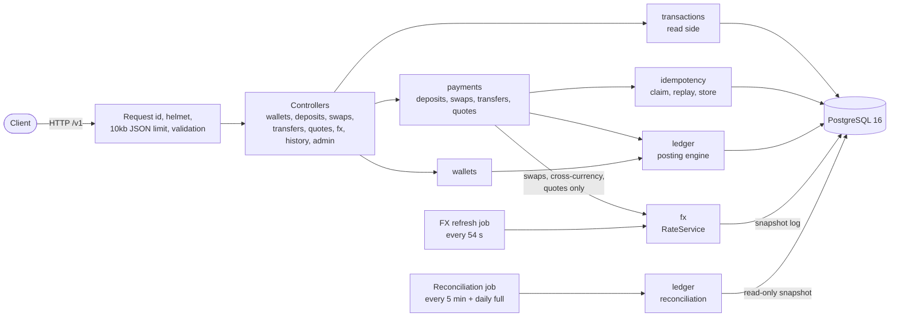
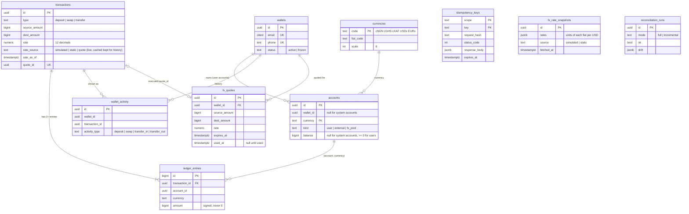

# Crossrail

Crossrail is the Operation Borderless prototype: a REST API for a multi-currency stablecoin wallet sandbox with wallets, simulated deposits, swaps, transfers, FX rates, history and reconciliation, built on a double-entry ledger in PostgreSQL.

Contents: [Quick start](#quick-start) · [Stack and why PostgreSQL](#stack-and-why-postgresql) · [Architecture](#architecture) · [Endpoints](#endpoint-walkthrough) · [Data model](#data-model) · [Deep dives](#deep-dives) · [Non-functional requirements](#non-functional-requirements) · [Trade-offs](#trade-offs) · [Failure modes](#failure-modes) · [At scale](#at-scale-or-with-real-rails) · [Assumptions and limits](#assumptions-limitations-and-what-id-do-with-more-time) · [API docs](#api-docs)

## Quick start

You need Docker and Node 24 (`.nvmrc`). Nothing else.

```bash
docker compose up --build        # Postgres 16 + API on :3000; migrations and seed run on start
```

In a second terminal:

```bash
corepack enable && yarn install --immutable
yarn demo                        # scripted walkthrough, prints every request and response
```

`yarn demo` exits 1 if any step deviates from what it expects, so it also works as a smoke test. The same steps are in [`demo.http`](demo.http) for the VS Code REST Client or the JetBrains HTTP client.

| Want | Command |
|---|---|
| Swagger UI | open <http://localhost:3000/docs> |
| Another host port (for example 5432 is taken) | `POSTGRES_PORT=5441 API_PORT=3300 docker compose up --build`, then `BASE_URL=http://localhost:3300 yarn demo` |
| Run against a local Postgres without Docker for the API | `cp .env.example .env`, point `DATABASE_URL` at it, `yarn db:migrate && yarn db:seed && yarn dev` |
| Full reconciliation from the CLI | `yarn reconcile` (exit 0 ok, 1 drift, 2 skipped, 3 failed); in the container: `docker compose exec api node dist/ledger/reconcile-cli.js` |
| Regenerate `openapi.json` and the Postman collection | `yarn openapi:export` (needs no database) |
| Local load test | `yarn load` (see [Non-functional requirements](#non-functional-requirements)) |

### Tests

```bash
yarn lint && yarn typecheck && yarn test
```

`yarn test` runs the unit specs (`src/**/*.spec.ts`), then the integration specs (`test/*.int-spec.ts`, in band) against a **real PostgreSQL 16**. Docker is required: [`test/global-setup.ts`](test/global-setup.ts) starts a throwaway `postgres:16.10-alpine` Testcontainer, runs the migrations and hands its connection string to the tests, so there is nothing to configure and no database of yours is touched. The tables are truncated and reseeded between tests.

The database is never mocked in the integration tests. They fake the clock (`FakeClock`) and the random source of the simulated feed, and in a few tests replace `RateService.getRate` to simulate an FX outage. CI ([`.github/workflows/ci.yml`](.github/workflows/ci.yml)) runs lint, typecheck, tests and build.

[`scripts/fresh-clone-check.sh`](scripts/fresh-clone-check.sh) is meant to prove the steps above from a clean checkout (it was written and its parts were run separately, but not end to end in one go): it clones the repository, runs `docker compose down -v` and `up -d --build`, waits for readiness, runs `yarn install --immutable && yarn test`, then `yarn demo`, and tears down. Run it with `bash scripts/fresh-clone-check.sh`. It uses its own compose project name and ports (3300 and 5441) so it cannot disturb other containers; `--working-tree` copies uncommitted files instead of cloning.

## Stack and why PostgreSQL

| Area | Choice |
|---|---|
| Runtime and language | Node 24, TypeScript with `strict`, `noUncheckedIndexedAccess`, `noImplicitOverride` |
| Framework | NestJS 11 on Express ([D1](docs/decisions.md)) |
| Database | PostgreSQL 16 through Drizzle ORM and `pg`; drizzle-kit migrations |
| Validation | class-validator DTOs (`whitelist`, `forbidNonWhitelisted`) for requests; Zod for configuration at boot |
| Money | native `bigint` minor units (scale 6); `decimal.js` only for rates, through a local clone with precision 40 and rounding down |
| Ids and time | UUIDv7 generated in the app; stored timestamps from the database's `now()`; application time from an injected `Clock` |
| Logging | nestjs-pino (JSON), request id on every line, email and phone redacted ([`logging.module.ts`](src/common/logging/logging.module.ts)) |
| Docs and tests | `@nestjs/swagger` at `/docs`; Jest, Supertest, Testcontainers, fast-check |

**Why PostgreSQL.** The problem is a ledger: several rows must change together or not at all, and the rules about them must hold under concurrency.

| Need | What Postgres gives | Where it is used |
|---|---|---|
| One logical operation touches 4 to 6 rows (entries, balances, key, response) | ACID transactions across any number of rows and tables | [`withTransaction`](src/common/db/with-transaction.ts); every payment is one transaction |
| Two requests must not both spend the same balance | `SELECT … FOR UPDATE` row locks, taken in a fixed order | [`LedgerService.post`](src/ledger/ledger.service.ts) |
| A balance can never go negative; a user account always has a balance | `CHECK` constraints | [`0001_ledger_schema.sql`](drizzle/0001_ledger_schema.sql) |
| Every transaction's entries sum to zero | Deferred constraint trigger, checked at `COMMIT` | [`0002_ledger_triggers.sql`](drizzle/0002_ledger_triggers.sql) |
| The ledger is never edited | `BEFORE UPDATE OR DELETE` triggers that raise | same file |
| Exactly one request claims an idempotency key | `INSERT … ON CONFLICT DO UPDATE … WHERE expires_at < now()` | [`idempotency.service.ts`](src/idempotency/idempotency.service.ts) |
| Amounts without rounding errors | `bigint` and `numeric(30,12)`; no floating point anywhere near money | [`money.ts`](src/common/money/money.ts) |
| One migration runner at a time | Advisory locks | [`src/db/migrate.ts`](src/db/migrate.ts) |

**Why not MongoDB.** Multi-document transactions exist but are an add-on, there are no row locks to order, no `CHECK` constraints and no deferred triggers, so "entries sum to zero" and "balance never negative" would live only in application code, where a bug or a second writer breaks them silently. Money needs the database to be the last line of defence. A document model also buys nothing here: the data is tabular and relational.

Not used, on purpose: Redis, queues, WebSockets, Prisma, TypeORM, floating-point arithmetic on money.

## Architecture



Rules the code enforces, each with a check:

- Only `src/ledger/` writes balances, entries and activity ([D22](docs/decisions.md)); deposits never import `src/fx/`, and a same-currency transfer never calls the rate service (an ESLint `no-restricted-imports` rule in [`eslint.config.mjs`](eslint.config.mjs) and the tests "keeps same-currency transfers working while FX is unavailable" and "never calls getRate while a database transaction is open").
- No network call and no rate lookup inside a database transaction ([D32](docs/decisions.md)).
- Controllers validate, call one application service and map the result.

### A cross-currency transfer

```mermaid
sequenceDiagram
  autonumber
  participant C as Client
  participant API as TransfersController / TransfersService
  participant FX as RateService (in memory)
  participant DB as PostgreSQL
  C->>API: POST /v1/wallets/A/transfers (Idempotency-Key, body)
  API->>API: validate body, parse amount, hash request
  API->>FX: getRate(cNGN, cGHS) before any transaction
  FX-->>API: rate "0.010000000000", source, as_of (or 503 FX_UNAVAILABLE)
  API->>DB: BEGIN (lock_timeout 2s, statement_timeout 5s)
  API->>DB: claim key: INSERT ... ON CONFLICT (scope, key)
  alt key already claimed and finished
    DB-->>API: stored response
    API-->>C: stored status and body, Idempotent-Replayed: true
  else claimed now
    API->>DB: SAVEPOINT; check both wallets exist
    API->>DB: SELECT ... FOR UPDATE user accounts, ascending id
    API->>DB: check balance and frozen status
    API->>DB: INSERT transaction, 4 entries, 2 activity rows; UPDATE balances
    API->>DB: store response against the key
    API->>DB: COMMIT (deferred trigger checks entries sum to zero)
    API-->>C: 201 + Location
  end
```

On a business rejection (for example `INSUFFICIENT_FUNDS`) the work is rolled back to the savepoint and the 422 itself is stored against the key, so a retry replays it ([D17](docs/decisions.md)). On deadlock, serialization failure or lock timeout the whole transaction is retried up to 3 times with jitter, then answered `503 RETRY_LATER`.

## Endpoint walkthrough

Every example below was captured from a real run of the API (`docker compose` build, simulated rate feed, a few minutes after boot, so the rates have already moved from their starting values). Ids and timestamps differ per run. Balances are abbreviated to the coins that changed. Amounts are strings with 6 decimals; JSON numbers are rejected. Errors are `application/problem+json`. [`demo.http`](demo.http) and the [Postman collection](postman/borderless.postman_collection.json) replay these calls.

| Method and path | Purpose | `Idempotency-Key` |
|---|---|---|
| `POST /v1/wallets` | create a wallet (email, phone or both) | no |
| `GET /v1/wallets/:id` | balances and an indicative USD total | no |
| `POST /v1/wallets/:id/deposits` | simulated deposit | required |
| `POST /v1/wallets/:id/swaps` | convert one coin to another | required |
| `POST /v1/wallets/:id/transfers` | send to another wallet, converting if needed | required |
| `POST /v1/fx/quotes` | lock a rate for 30 s | no |
| `GET /v1/fx/rates` | all 20 ordered pairs | no |
| `GET /v1/wallets/:id/transactions` | history, newest first, keyset pagination | no |
| `GET /v1/transactions/:id` | one transaction with its signed entries | no |
| `GET /v1/admin/reconciliation`, `POST /v1/admin/reconciliation/run` | admin, unauthenticated | no |
| `GET /health/live`, `GET /health/ready` | liveness, readiness | no |

### Create a wallet

```http
POST /v1/wallets
{ "email": "ada.d85111@example.com", "phone": "08031851110" }
```

```http
201 Created
Location: /v1/wallets/01a18f5d-ca0a-7779-a9e4-ad6fbdfc4a4f
```

```json
{
  "id": "01a18f5d-ca0a-7779-a9e4-ad6fbdfc4a4f",
  "email": "ada.d85111@example.com",
  "phone": "+2348031851110",
  "status": "active",
  "created_at": "2026-10-31T00:30:50.889Z",
  "balances": [
    { "currency": "cNGN", "amount": "0.000000" },
    { "currency": "cGHS", "amount": "0.000000" },
    { "currency": "cXAF", "amount": "0.000000" },
    { "currency": "USDx", "amount": "0.000000" },
    { "currency": "EURx", "amount": "0.000000" }
  ],
  "total_usd": { "amount": "0.00", "rates_as_of": "2026-10-31T00:30:34.868Z", "source": "simulated", "indicative": true }
}
```

Phone numbers are parsed with region NG by default and stored as E.164; email is case-insensitive and unique ([D19](docs/decisions.md)). Creating a wallet needs no key: a duplicate is a `409 WALLET_ALREADY_EXISTS`.

### Swap

```http
POST /v1/wallets/01a18f5d-ca0a-7779-a9e4-ad6fbdfc4a4f/swaps
Idempotency-Key: 4a0c9f4e-3f0c-4b43-9a53-0f4d2b7f1a10
{ "from_currency": "cNGN", "to_currency": "USDx", "amount": "100000" }
```

```json
{
  "transaction": {
    "id": "01a18f5d-ca6c-764c-b1c5-3e5969042597",
    "type": "swap",
    "source_currency": "cNGN", "source_amount": "100000.000000",
    "dest_currency": "USDx",   "dest_amount": "66.849206",
    "rate": "0.000668492068",
    "rate_source": "simulated",
    "rate_as_of": "2026-10-31T00:30:34.868Z",
    "created_at": "2026-10-31T00:30:50.982Z"
  },
  "balances_after": [ { "currency": "cNGN", "amount": "900000.000000" }, "…", { "currency": "USDx", "amount": "66.849206" } ]
}
```

`dest_amount = floor(source_amount x rate)` with the exact 12-decimal `rate` that is recorded, so any reviewer can reproduce it (test "records a rate that reproduces dest_amount exactly: floor(source x rate)"). `rate_source` is `simulated` for the simulated feed (see [FX rates and failures](#fx-rates-and-failures)).

### Cross-currency transfer and replay

```http
POST /v1/wallets/01a18f56-3171-725c-83fa-6b177e8e21f4/transfers
Idempotency-Key: bd2cd2e9-afa4-4ec3-b508-c76c7a601887
{ "to_wallet_id": "01a18f56-3197-770e-b086-d7d4871a0c07", "source_currency": "cNGN", "destination_currency": "cGHS", "amount": "50000" }
```

```json
{
  "transaction": {
    "id": "01a18f56-31f4-74cf-a790-71252b687f09",
    "type": "transfer",
    "sender_wallet_id": "01a18f56-3171-725c-83fa-6b177e8e21f4",
    "receiver_wallet_id": "01a18f56-3197-770e-b086-d7d4871a0c07",
    "source_currency": "cNGN", "source_amount": "50000.000000",
    "dest_currency": "cGHS",   "dest_amount": "500.000000",
    "rate": "0.010000000000", "rate_source": "simulated",
    "rate_as_of": "2026-10-31T00:22:20.646Z",
    "created_at": "2026-10-31T00:22:33.196Z"
  },
  "balances_after": [ { "currency": "cNGN", "amount": "850000.000000" }, "…" ]
}
```

Sending the same request again returns `201` with the header `Idempotent-Replayed: true` and a byte-identical body (the demo prints both). `destination_currency` defaults to the source; a same-currency transfer has no rate fields and never reads a rate.

### Quote, then swap at the locked rate

```http
POST /v1/fx/quotes
{ "wallet_id": "01a18f5d-ca0a-7779-a9e4-ad6fbdfc4a4f", "from_currency": "cNGN", "to_currency": "USDx", "amount": "1500" }
```

```json
{
  "quote_id": "01a18f5d-ca7f-728b-94f9-9ac6f13eedcf",
  "rate": "0.000668492068",
  "source_amount": "1500.000000",
  "destination_amount": "1.002738",
  "source": "simulated",
  "expires_at": "2026-10-31T00:31:21.007Z"
}
```

A swap or cross-currency transfer from the same wallet, for the same pair and amount, may then carry `"quote_id": "…"`. It executes at the stored rate and amounts and records `"rate_source": "quote"` and the `quote_id`. A second use:

```json
{ "type": "urn:problem:quote-used", "title": "Quote already used", "status": 422, "detail": "Quote already used",
  "code": "QUOTE_USED", "request_id": "01a18f5d-caa5-766a-85d3-598b44a43997" }
```

Checks run in this order: unknown (404 `QUOTE_NOT_FOUND`), wrong wallet, pair or amount (422 `QUOTE_MISMATCH`), already used (`QUOTE_USED`), expired (`QUOTE_EXPIRED`, `now >= expires_at`). See [D51 to D55](docs/decisions.md).

### Errors

Validation failures list every field:

```json
{ "type": "urn:problem:validation-error", "title": "Validation error", "status": 400,
  "detail": "Request validation failed", "code": "VALIDATION_ERROR", "request_id": "01a18f5d-cad7-7248-a5de-e2ec3390c714",
  "errors": [ { "field": "amount", "message": "amount must be a string" } ] }
```

A missing key on a money endpoint:

```json
{ "type": "urn:problem:idempotency-key-required", "title": "Idempotency-Key header is required", "status": 400,
  "detail": "Send an Idempotency-Key header (1 to 255 printable ASCII characters, no spaces)",
  "code": "IDEMPOTENCY_KEY_REQUIRED", "request_id": "01a18f5d-cae2-7448-9ef9-afdc71c3d47f" }
```

| Code | HTTP | Meaning |
|---|---|---|
| `VALIDATION_ERROR` | 400 | bad body, query or id; `errors[]` lists fields |
| `IDEMPOTENCY_KEY_REQUIRED`, `IDEMPOTENCY_KEY_INVALID` | 400 | missing or malformed key |
| `UNSUPPORTED_CURRENCY`, `SAME_CURRENCY_SWAP`, `SELF_TRANSFER`, `INVALID_CURSOR` | 400 | the named rule was broken |
| `WALLET_NOT_FOUND`, `RECIPIENT_NOT_FOUND`, `TRANSACTION_NOT_FOUND`, `QUOTE_NOT_FOUND` | 404 | unknown id |
| `WALLET_ALREADY_EXISTS` | 409 | duplicate email or phone |
| `INSUFFICIENT_FUNDS`, `AMOUNT_TOO_SMALL`, `AMOUNT_LIMIT_EXCEEDED`, `WALLET_FROZEN` | 422 | business rule |
| `IDEMPOTENCY_KEY_REUSED` | 422 | same key, different request |
| `QUOTE_EXPIRED`, `QUOTE_USED`, `QUOTE_MISMATCH` | 422 | quote rule |
| `FX_UNAVAILABLE`, `RETRY_LATER` | 503 | with `Retry-After` |
| `INTERNAL_ERROR` | 500 | unexpected; details are logged, never returned |

Every operation's own codes are listed in the [OpenAPI document](openapi.json); a unit test ([`src/docs/openapi.spec.ts`](src/docs/openapi.spec.ts)) checks that each code exists and that its status matches the catalogue, and an integration test ([`test/docs-examples.int-spec.ts`](test/docs-examples.int-spec.ts)) checks that the documented examples have the same keys as real responses.

### History, detail, rates, reconciliation

`GET /v1/wallets/:id/transactions?type=&currency=&limit=&cursor=` returns `{ "data": [ … ], "next_cursor": "…" | null }`, newest first, `limit` 1 to 100 (default 20). Items: `transaction_id`, `type` (`deposit`, `swap`, `transfer_in`, `transfer_out`), `currency_out`/`amount_out`, `currency_in`/`amount_in` (null for the absent side), `counterparty_wallet_id`, `rate`, `rate_source`, `created_at`. The cursor is opaque and carries microsecond timestamps ([D44](docs/decisions.md)).

`GET /v1/transactions/:id` for the swap above:

```json
{
  "id": "01a18f5d-ca6c-764c-b1c5-3e5969042597", "type": "swap", "status": "completed",
  "initiator_wallet_id": "01a18f5d-ca0a-7779-a9e4-ad6fbdfc4a4f", "counterparty_wallet_id": null,
  "source_currency": "cNGN", "source_amount": "100000.000000", "dest_currency": "USDx", "dest_amount": "66.849206",
  "rate": "0.000668492068", "rate_source": "simulated", "rate_as_of": "2026-10-31T00:30:34.868Z", "created_at": "2026-10-31T00:30:50.982Z",
  "entries": [
    { "account_kind": "user",    "wallet_id": "01a18f5d-ca0a-7779-a9e4-ad6fbdfc4a4f", "currency": "cNGN", "amount": "-100000.000000" },
    { "account_kind": "fx_pool", "wallet_id": null, "currency": "cNGN", "amount": "100000.000000" },
    { "account_kind": "fx_pool", "wallet_id": null, "currency": "USDx", "amount": "-66.849206" },
    { "account_kind": "user",    "wallet_id": "01a18f5d-ca0a-7779-a9e4-ad6fbdfc4a4f", "currency": "USDx", "amount": "66.849206" }
  ]
}
```

`GET /v1/fx/rates` returns `{ base, provider, source, as_of, refreshed_at, rates: [ { from, to, rate, source, refreshed_at } x 20 ] }` with 12-decimal rates in registry order. `POST /v1/admin/reconciliation/run?mode=full|incremental` (after the load test above):

```json
{ "id": "01a18f5d-1d82-77c8-82c3-9f687024867d", "mode": "full", "started_at": "2026-10-31T00:30:06.692Z", "finished_at": "2026-10-31T00:30:06.722Z",
  "window_from": null, "accounts_checked": 110, "ok": true, "drift": [],
  "currency_net": { "EURx": "0.000000", "USDx": "0.000000", "cGHS": "0.000000", "cNGN": "0.000000", "cXAF": "0.000000" },
  "unbalanced_transactions": [] }
```

## Data model



Migrations are in [`drizzle/`](drizzle) (0000 extensions, 0001 ledger schema, 0002 triggers, 0003 snapshots, 0004 reconciliation runs, 0005 history index, 0006 quotes). `transactions`, `ledger_entries` and `wallet_activity` are append-only by trigger; `accounts`, `fx_quotes`, `idempotency_keys` and `fx_rate_snapshots` are mutable by design.

### Chart of accounts

| Account | Kind | Count | Balance | Meaning |
|---|---|---|---|---|
| user account | `user` | one per wallet and coin (5 per wallet) | stored, `>= 0` | a customer's money |
| external | `external` | one per coin | none (sum of its entries) | the outside world; deposits come from here |
| FX pool | `fx_pool` | one per coin | none (sum of its entries) | counterparty of every conversion; holds rounding dust |

System accounts have a `NULL` balance and are never locked ([D9](docs/decisions.md)), so concurrent deposits do not queue on one row. The seed creates the 10 system accounts ([`src/db/seed.ts`](src/db/seed.ts)).

### Posting table

| Operation | Entries (amount signed, per currency they sum to zero) | Activity rows |
|---|---|---|
| Deposit of A in coin X | `external(X) -A`, `user(X) +A` | `deposit` |
| Swap S of X into Y, D = floor(S x rate) | `user(X) -S`, `fx_pool(X) +S`, `fx_pool(Y) -D`, `user(Y) +D` | `swap` |
| Same-currency transfer of A in X | `sender(X) -A`, `receiver(X) +A` | `transfer_out`, `transfer_in` |
| Cross-currency transfer of A in X, received as Y | `sender(X) -A`, `fx_pool(X) +A`, `fx_pool(Y) -D`, `receiver(Y) +D` | `transfer_out`, `transfer_in` |

The FX pool keeps the whole sold amount and pays only the floored destination, so the rounding remainder stays in the pool (test "rounding dust stays in the fx pool: it gains the full sold amount, pays only the floor"; [D33](docs/decisions.md)).

## Deep dives

### Money precision

- Amounts are `bigint` minor units at scale 6. API input must match `^\d+(\.\d{1,6})?$`, be greater than zero and at most `MAX_TX_AMOUNT` (1,000,000,000 units). JSON numbers, exponents, signs, hex and whitespace are rejected (tests "rejects a JSON number amount with 400" and the `it.each` list of bad amounts in [`test/deposits.int-spec.ts`](test/deposits.int-spec.ts)). Responses always print 6 decimals as strings, and bigint values are serialised as strings, never as numbers ([`bigint-replacer.ts`](src/common/json/bigint-replacer.ts)).
- Rates are `decimal.js` values from a local clone (precision 40, round down), pivoted through USD and floored to **12 decimals**; that exact string is what gets recorded and used, so `floor(source x rate)` is reproducible from the stored row ([D24, D25](docs/decisions.md)). A destination of 0 is rejected as `AMOUNT_TOO_SMALL` and stored against the key.
- `Number()`, `parseInt`, `parseFloat`, `toFixed`, `Date.now()` and `new Date()` are banned in `src/` by lint ([`eslint.config.mjs`](eslint.config.mjs)).
- Balances above 2^53 survive a round trip (test "round-trips a balance above 2^53 without losing precision").
- The USD total on a wallet is indicative: each balance is converted and floored on its own to 2 decimals ([D28](docs/decisions.md)).

### Idempotency

- Money-moving POSTs need an `Idempotency-Key` header (1 to 255 printable ASCII characters). The key is scoped to the wallet and route (`wallet:{id}:POST /v1/wallets/:id/swaps`), so the same key on two wallets is two requests; the request body is hashed canonically (`"10"` and `"10.0"` hash the same). The record lives 24 hours (`IDEMPOTENCY_TTL_HOURS`) ([D16](docs/decisions.md)).
- The **claim, the money movement and the stored response commit in one database transaction**. There is no window in which money has moved but the key is free, or the key is taken but nothing happened.
- A winner claims the row; a concurrent request with the same key waits on the row lock, then replays the stored response. Same key and same body replays with `Idempotent-Replayed: true`; same key and a different body is `422 IDEMPOTENCY_KEY_REUSED`.
- Business rejections (422) are stored and replayed, because the answer will not change; the work done before the rejection is undone with a savepoint. 5xx and 503 errors are not stored: the key is released so the retry can succeed. Validation errors, 404 and missing keys are never stored ([D17](docs/decisions.md)).
- Replays are byte-identical even though the response is kept as `jsonb` ([D18](docs/decisions.md)), and a replay never needs FX: an earlier success is replayed during an FX outage.
- The same ordering rule applies to quotes: the key is claimed first, so a retry of a successful quoted swap gets the stored 201, never `QUOTE_USED` ([D52](docs/decisions.md)).

### Concurrency

- User accounts are locked with `SELECT … FOR UPDATE` in **ascending account id order**, every time, inside `LedgerService.post`; a transfer A to B and one B to A therefore queue instead of deadlocking (tests "does not deadlock when 10 A to B and 10 B to A transfers run at once" and "never needs a deadlock retry for opposite-direction postings"). With a quote, the quote row is locked first ([D53](docs/decisions.md)).
- Balance checks happen under the lock: of 20 simultaneous swaps of 10 from a balance of 100, exactly 10 succeed and 10 are `INSUFFICIENT_FUNDS` (test "20 simultaneous swaps of 10 cNGN from a 100 cNGN wallet: exactly 10 succeed, 10 are INSUFFICIENT_FUNDS").
- `withTransaction` sets `lock_timeout` 2 s and `statement_timeout` 5 s, retries the whole function on deadlock, serialization failure and lock timeout up to 3 times with jitter of 50 to 400 ms, then answers `503 RETRY_LATER` with `Retry-After: 1` ([`with-transaction.spec.ts`](src/common/db/with-transaction.spec.ts)).
- Every request has a 10 s budget (`REQUEST_TIMEOUT_MS`); the handler is not cancelled, which is why a timed-out request can still be replayed safely ([D6](docs/decisions.md)).
- Wallet creation under a race: of five simultaneous creates with one email, exactly one wins (test "lets exactly one of five simultaneous creates with the same email win").

### FX rates and failures

- **Rates are simulated.** No external provider, no key: the `SimulatedFxProvider` ([`src/fx/simulated-fx-provider.ts`](src/fx/simulated-fx-provider.ts)) moves each non-USD rate by a small step most of the time (up to 0.3%) and a medium step now and then (up to 1.5%), kept inside a 30% band around [`config/static-rates.json`](config/static-rates.json), every 54 seconds. The provider holds no state: each step starts from the newest stored table, so a rejected step is never built on ([D46, D47](docs/decisions.md)). `FX_PROVIDER=static` gives fixed rates.
- Snapshots and conversions are recorded with their own source, `simulated` (or `static` with `FX_PROVIDER=static`), so stored data can tell the feed from a real market; `quote` marks a conversion executed at a locked rate. The rates endpoint and readiness also say `provider: simulated`; this is not market data ([D48, D61](docs/decisions.md)).
- Every table is validated before it is stored or used: all five fiats present, plain positive decimals within bounds, USD exactly 1, no move over `FX_MAX_MOVE_PCT` (20%) against the previous table. A rejected table is never persisted; the reason shows as `last_error` in `/health/ready`, which stays 200 ([D49](docs/decisions.md)).
- Rates are read from memory **before** `BEGIN`; the refresh job and requests never share a database transaction ([D23, D32](docs/decisions.md)). Consequences, each tested:

| Situation | Behaviour | Test |
|---|---|---|
| FX unavailable | deposits and same-currency transfers keep working | "keeps same-currency transfers working while FX is unavailable" |
| FX unavailable | cross-currency transfer is `503 FX_UNAVAILABLE`, key released | "answers 503 for a cross-currency transfer during an outage and releases the key" |
| FX unavailable | replay of an earlier success still answers | "replays an earlier success even while FX is unavailable, and releases a key that hit the outage" |
| Unknown wallet during an outage | `404`, not `503` | "answers 404, not 503, for an unknown wallet during an FX outage" |
| Rate changes between request and replay | the replay shows the original rate | "replays the original response (and rate) after the live rate has changed" |

### Reconciliation

- `ReconciliationService` ([`src/ledger/`](src/ledger)) compares stored balances with the sum of each account's entries and checks that every transaction's entries sum to zero per currency and number at least two. It reads one `REPEATABLE READ READ ONLY` snapshot, so postings in flight cannot produce false drift (test "reports no false drift while 50 transfers are in flight"), and takes an advisory lock so only one run executes at a time ([D39, D40](docs/decisions.md)).
- It **detects drift and never repairs it** (test "exposes no way to repair: there is no write route besides run"). With `RECON_FREEZE_ON_DRIFT=true` it can freeze the affected wallets ([D42](docs/decisions.md)).
- It runs every 5 minutes (incremental, by time window) and daily at 02:00 UTC (full), only when `SCHEDULERS_ENABLED=true`; `yarn reconcile` and `POST /v1/admin/reconciliation/run` run it on demand. Real reconciliation would also compare against an external statement ([D43](docs/decisions.md)).

## Non-functional requirements

| Area | Requirement | How it is met | Evidence |
|---|---|---|---|
| Correctness | no lost or duplicated money | double entry, deferred zero-sum trigger, append-only ledger, balance `CHECK` | [`ledger-constraints.int-spec.ts`](test/ledger-constraints.int-spec.ts) |
| Correctness | stored balances equal the entries | reconciliation, plus a property test of 300 random operations | "300 random operations (valid and invalid) leave a ledger that reconciles with no negative balance" |
| Idempotency | retries are safe | key claim, work and response in one transaction | [`idempotency.int-spec.ts`](test/idempotency.int-spec.ts) |
| Concurrency | no overspend, no deadlock | row locks in id order, retries with jitter | [`swaps.int-spec.ts`](test/swaps.int-spec.ts), [`transfers.int-spec.ts`](test/transfers.int-spec.ts) |
| Availability | an FX failure does not stop deposits or same-currency transfers | rates resolved from memory; those paths never read a rate | see FX table above |
| Latency | request budget 10 s; DB `lock_timeout` 2 s, `statement_timeout` 5 s | `REQUEST_TIMEOUT_MS`, `withTransaction` | [`with-transaction.spec.ts`](src/common/db/with-transaction.spec.ts) |
| Limits | body 10 kb; amount at most 1,000,000,000 units; pool 10 connections (`DB_POOL_MAX`) | Express body limit, `MAX_TX_AMOUNT` | [`http-basics.int-spec.ts`](test/http-basics.int-spec.ts) |
| Security | helmet headers, no CORS, no secrets in the repository | `configureApp` | [`http-basics.int-spec.ts`](test/http-basics.int-spec.ts); there is no authentication (see limits) |
| Privacy | no raw email or phone in logs | pino redaction | [`logging.module.ts`](src/common/logging/logging.module.ts) |
| Observability | JSON logs with a request id on every line; `X-Request-Id` echoed; liveness and readiness | nestjs-pino, request id middleware, [`health.controller.ts`](src/health/health.controller.ts) | [`health.int-spec.ts`](test/health.int-spec.ts) |
| Testability | real database, fake clock | Testcontainers, `FakeClock`, seeded random | [`test/`](test) |

### Load test (local, indicative)

`yarn load` ([`scripts/load.ts`](scripts/load.ts), autocannon) alternates deposits and swaps over 20 pre-funded wallets, 20 connections, 60 seconds, a unique idempotency key per request.

| Item | Value |
|---|---|
| Date | 2026-10-31 |
| Target | `docker compose up` in WSL2 (API container, Postgres 16 container, `DB_POOL_MAX` 10, simulated feed on), client on the Windows host through localhost |
| Machine | Intel Core i5-8250U (4 cores, 8 threads), 15.9 GB RAM, Windows 11; WSL2 limited to 8 threads and 7.8 GB |
| Requests | 6,530, all 2xx, 0 errors, 0 timeouts |
| Throughput | 108.8 requests per second (average) |
| Latency | p50 173 ms, p97.5 311 ms, p99 398 ms, max 606 ms |
| After the run | a full reconciliation reported `ok: true`, no drift, 110 accounts checked |

These numbers come from a laptop with the client, Docker and the database sharing the machine. They are a sanity check that the locking and idempotency paths hold up under load, not a capacity claim.

## Trade-offs

| Decision | Alternatives | Why | Cost |
|---|---|---|---|
| Stored balance plus entries ([D8](docs/decisions.md)) | balance computed by summing entries | constant-time reads and a lockable row; entries remain the truth and reconciliation compares them | two things to keep equal; the ledger service is the only writer |
| System accounts have no stored balance ([D9](docs/decisions.md)) | a locked balance on `external` and `fx_pool` | deposits and swaps on different wallets never queue on one row | their balance is derived from entries |
| Row locks in id order, no serializable isolation | `SERIALIZABLE` and retry; advisory locks | simple, predictable, no abort storms on a hot account | callers must go through `LedgerService.post` |
| Rates resolved before `BEGIN` ([D32](docs/decisions.md)) | look up the rate inside the transaction | no I/O while holding locks; a slow feed cannot hold a row lock | the rate used can be a few seconds old; it is recorded with `rate_as_of` |
| Business 422s are stored against the key ([D17](docs/decisions.md)) | store only successes | a retry cannot flip from "rejected" to "accepted" if state changed | a client must use a new key after fixing the cause |
| Quote consumed after the key claim ([D52](docs/decisions.md)) | check the quote before the claim | a retry of a successful swap replays instead of failing | a failed swap rolls back `used_at`, so the quote stays usable |
| Simulated feed instead of a real provider ([D46](docs/decisions.md)) | a live FX API with retries, a circuit breaker and fallback tiers | no key, no network, deterministic tests | the resilience a real provider needs (timeouts, breaker, stale tiers) is not exercised |
| A `simulated` rate source ([D61](docs/decisions.md)) | keep labelling simulated rates `live` ([D48](docs/decisions.md)) | stored rows say what produced the rate | the `rate_source` vocabulary grew by one value; old `live` rows (history) stay as they were |
| One ACID transaction for transfers ([D36](docs/decisions.md)) | saga with outbox | both wallets are in one database | a real payout to an outside rail needs the saga (see below) |
| Reconciliation detects, never repairs ([D39](docs/decisions.md)) | auto-correct drift | silent repair hides the bug that caused it | a person must act on drift |
| Cursor pagination with microsecond timestamps ([D44](docs/decisions.md)) | offset pagination | no skipped or repeated rows while new activity arrives | the cursor is opaque and tied to the sort order |
| Unauthenticated admin routes ([D45](docs/decisions.md)) | an auth layer | no auth model in a sandbox | anyone who can reach the API can run a reconciliation |

## Failure modes

| Failure | What would go wrong | What the system does | Test |
|---|---|---|---|
| Client times out and retries a payment | double debit | same key and body replays the stored response; one transaction | `test/idempotency.int-spec.ts` "runs one transaction and returns identical bodies for 10 simultaneous same-key requests" |
| Same key reused with a different body | wrong operation replayed | `422 IDEMPOTENCY_KEY_REUSED` | `test/idempotency.int-spec.ts` "rejects the same key with a different amount: 422 IDEMPOTENCY_KEY_REUSED" |
| Failure after some writes inside a payment | partial movement | the work rolls back to the savepoint; only the rejection is stored | `test/idempotency.int-spec.ts` "undoes partial work when a business rejection happens after some writes" |
| 5xx inside the work | key stuck, retry blocked | key released, retry succeeds | `test/idempotency.int-spec.ts` "releases the key after a 5xx inside the work, so the retry succeeds" |
| Concurrent spends of one balance | overdraft | row lock then check; exactly the affordable ones succeed | `test/swaps.int-spec.ts` "20 simultaneous swaps of 10 cNGN from a 100 cNGN wallet: exactly 10 succeed, 10 are INSUFFICIENT_FUNDS" |
| Opposite transfers touch the same two accounts | deadlock | ascending lock order; no retry needed | `test/ledger-service.int-spec.ts` "never needs a deadlock retry for opposite-direction postings" |
| Many transfers each need most of a balance | two succeed and overdraw | exactly one succeeds | `test/transfers.int-spec.ts` "lets exactly one of 10 simultaneous transfers that each need 60% of the balance succeed" |
| Unbalanced entries (a bug) | money created or destroyed | the posting engine refuses first; the deferred trigger fails the commit | `test/ledger-service.int-spec.ts` "fails fast with INTERNAL_ERROR when legs do not sum to zero, before writing anything"; `test/ledger-constraints.int-spec.ts` "fails at commit with 23514 when entries do not sum to zero" |
| Negative or missing balance written directly | invalid state | `CHECK` constraints reject it | `test/ledger-constraints.int-spec.ts` "rejects a user balance below zero" |
| Ledger row edited or deleted | history rewritten | append-only triggers raise | `test/ledger-constraints.int-spec.ts` (append-only tables reject update and delete) |
| FX unavailable | whole API down | deposits and same-currency transfers continue; cross-currency gets 503 and releases the key | `test/transfers.int-spec.ts` "keeps same-currency transfers working while FX is unavailable", "answers 503 for a cross-currency transfer during an outage and releases the key" |
| Feed produces a bad table (zero rate, wild jump) | wrong conversions | table rejected, never stored, `last_error` shown, service stays ready | `test/fx-simulated.int-spec.ts` "rejects a bad table from the feed: nothing stored, nothing changed, the error is reported", "rejects a wild jump even from a well-formed table" |
| Rate network call inside a transaction | locks held during I/O | guard fails any `getRate` while a transaction is open | `test/swaps.int-spec.ts` "never calls getRate while a transaction is open" |
| Dust amount | customer gives money, receives nothing | `AMOUNT_TOO_SMALL`, nothing moves, stored against the key | `test/swaps.int-spec.ts` "rejects dust with AMOUNT_TOO_SMALL, changes nothing, and stores the rejection against the key" |
| Quote used twice, even simultaneously | rate honoured twice | the quote row lock serialises; one 201, one `QUOTE_USED`; the database also refuses a second transaction | `test/quotes.int-spec.ts` "lets exactly one of two simultaneous swaps on one quote succeed", "cannot record two transactions for one quote, even by writing to the table directly" |
| Quoted swap retried after success | `QUOTE_USED` for the client's own success | replay of the stored 201 | `test/quotes.int-spec.ts` "replays a quoted swap with the same key as the original 201, not QUOTE_USED" |
| Swap fails after the quote check | quote burned | rollback to the savepoint keeps the quote usable | `test/quotes.int-spec.ts` "does not burn the quote when the swap itself fails for insufficient funds" |
| Frozen wallet | spending from a wallet under investigation | debits `WALLET_FROZEN`; credits still allowed | `test/transfers.int-spec.ts` "rejects a frozen sender with 422 WALLET_FROZEN (stored), but a frozen recipient still receives" |
| Drift between balances and entries | silent corruption | reconciliation reports it and does not repair it | `test/reconciliation.int-spec.ts` "reports an account whose balance is 1 minor unit too high, and leaves it alone" |
| Reconciliation races with payments | false drift | one repeatable-read snapshot | `test/reconciliation.int-spec.ts` "reports no false drift while 50 transfers are in flight" |
| Two reconciliation runs at once | double work, contention | advisory lock; the second is skipped | `test/reconciliation.int-spec.ts` "returns { skipped: true } when another run holds the lock, and writes no row" |
| Two migrations run at once (two replicas booting) | corrupted schema | advisory lock | `test/migrate-seed.int-spec.ts` "can run twice at the same time on a fresh database thanks to the advisory lock" |
| Database down | request hangs or leaks an error | `503 RETRY_LATER`; readiness reports it | `src/common/errors/problem-json.filter.spec.ts` (DB-down case), `src/health/health.controller.spec.ts` |
| Pagination while data changes | skipped or repeated rows | keyset cursor with microsecond precision | `test/history.int-spec.ts` "a deposit inserted mid-walk causes no duplicates and no gaps" |
| Oversized or malformed input | crashes, float rounding | strict DTOs, amount regex, 10 kb limit | `test/http-basics.int-spec.ts`; `test/swaps.int-spec.ts` "rejects a JSON number amount, a missing field and an unknown field with 400" |

## At scale or with real rails

| Today | With real traffic or real rails |
|---|---|
| One API instance owns the in-memory rate snapshot and the schedulers; several replicas would each refresh and each run reconciliation (the advisory lock only stops overlap) | a shared rate cache (or Redis) with a leader-elected refresh; one scheduler owner |
| A transfer is one database transaction because both wallets live in one database | an outbox plus a saga for external payouts: record intent in the ledger transaction, send through a worker, confirm or reverse |
| Reconciliation compares the ledger with itself | reconcile against bank, custodian and partner statements and on-chain balances; raise breaks for people to resolve ([D43](docs/decisions.md)) |
| One `external` and one `fx_pool` account per coin; one row lock per wallet account | partition or shard hot wallets and system accounts; sub-accounts for the FX pool |
| Direct Postgres connections, pool of 10 | PgBouncer in transaction mode; read replicas for history |
| No fees, no spread | fees as a third posting leg to a revenue account; a spread in the rate |
| No authentication or authorisation; admin routes are open | authentication, per-wallet scoping, KYC and limits, role-gated admin |
| `rate_source = simulated` for a simulated feed | a real provider adapter behind the same port, with timeouts, a circuit breaker and stale tiers in `RateService.refresh()` ([D46](docs/decisions.md)) |
| Idempotency rows expire by timestamp but are not deleted | a cleanup job; partition the keys table by day |

## Assumptions, limitations and what I'd do with more time

**Assumptions**

- Every coin is pegged 1:1 to its fiat (cNGN to NGN, cGHS to GHS, cXAF to XAF, USDx to USD, EURx to EUR), with no spread ([D26](docs/decisions.md)).
- The FX pool has unlimited liquidity: a swap never fails because the pool is short.
- No authentication: any caller can act on any wallet and on the admin routes.
- Deposits are simulated: they credit from the `external` account and nothing real moves.
- One application instance.

**Known limitations**

- Rates are simulated and labelled `simulated` in stored data ([D61](docs/decisions.md)); transactions written before that change keep `live`.
- Expired quotes and idempotency keys are never deleted; `fx_rate_snapshots` grows by about 1,600 rows a day ([D50](docs/decisions.md)).
- There is no rate limiting.
- A wallet can only be frozen by reconciliation with `RECON_FREEZE_ON_DRIFT=true`; there is no endpoint, and no unfreeze.
- A quote can be used by a swap or by a cross-currency transfer from its wallet ([D54](docs/decisions.md)).
- `GET /v1/transactions/:id` is not scoped to a wallet.
- The load numbers above come from one laptop.
- Cross rates are floored to 12 decimals, so a low-value pair such as cNGN to USDx (0.000668492068) loses about 1.5e-6 of relative precision per conversion; the recorded rate is exact and the amount reproducible.
- If the feed fails, the last snapshot is kept without an age limit (see "With more time").

**With more time**

- A maximum rate age: today, if the feed kept failing, the last snapshot would be used indefinitely and still labelled `simulated`. Past one refresh interval it should be labelled `cached` (a `rate_source` value the schema allows but nothing emits yet), and past a maximum age cross-currency calls should answer `503 FX_UNAVAILABLE`.
- Test the real outage path: the simulated feed never fails, so the FX-unavailable behaviour above is tested by replacing `RateService.getRate`, not by a failing provider.
- Be explicit that the quotes, the reconciliation scheduler and admin API, the Postman generator and the load test go beyond the brief; keep only what can be defended.
- A log-redaction test (redaction is configured in `logging.module.ts` but no test asserts it) and a lock on the frozen-wallet check (it reads wallet status without a row lock, so a freeze racing a debit could let one debit through).

- Authentication and per-wallet authorisation; rate limiting (for example `@nestjs/throttler`).
- Fees and a spread as extra posting legs.
- Reversals as compensating entries, so corrections are possible without editing the ledger.
- WebSockets or server-sent events for rate updates.
- A cleanup job for idempotency keys, quotes and old snapshots.
- A real FX provider adapter with a circuit breaker and stale tiers.
- Contract tests against the OpenAPI document for every error example (today the examples are checked for shape).

## API docs

| What | Where |
|---|---|
| Swagger UI | `/docs` on a running API (<http://localhost:3000/docs>) |
| OpenAPI 3 document | [`openapi.json`](openapi.json), regenerated with `yarn openapi:export` and checked against the code by [`src/docs/openapi.spec.ts`](src/docs/openapi.spec.ts) |
| Postman collection | [`postman/borderless.postman_collection.json`](postman/borderless.postman_collection.json): a `baseUrl` variable, a folder per area, `Idempotency-Key: {{$guid}}`, test scripts that save `wallet_id` and friends; run "Create a wallet" and "Create a second wallet" first |
| REST Client script | [`demo.http`](demo.http) |
| Scripted demo | `yarn demo` ([`scripts/demo.ts`](scripts/demo.ts)) |
| Decision log | [`docs/decisions.md`](docs/decisions.md) (D1 to D61, not contiguous) |
